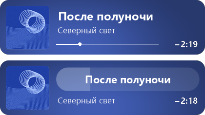

# WaveCard

WaveCard показывает в OBS обложку, название, исполнителя и оставшееся время трека из настольной Яндекс Музыки. Нативный источник для Windows x64. Проверен с OBS Studio 33.0.1.



## Установка

1. Скачайте **WaveCard-Setup.exe** в разделе **Releases**. Закройте OBS и запустите установщик. Для переносного OBS выберите его корневую папку.
2. Откройте OBS. В панели **Источники** нажмите **+ → Я.Музыка**.
3. Включите трек в приложении Яндекс Музыки. В свойствах источника выберите стиль и размер.

Звук передаётся через привычный аудиоисточник OBS. Карточка использует системный медиасеанс Windows. [Инструкция на русском и английском](START.txt).

## Build

Use Windows x64, MinGW-w64 (tested with w64devkit 2.11.0), OBS Studio 33.0.1 and its matching source tree. Run in PowerShell:

```powershell
./src/build.ps1 -CompilerBin C:/w64devkit/bin -ObsSource C:/src/obs-studio-33.0.1 -ObsInstall 'C:/Program Files/obs-studio'
```

Report bugs in Issues with your OBS version and steps to reproduce. WaveCard is an independent project developed with AI assistance. License: GPL-2.0-or-later.
